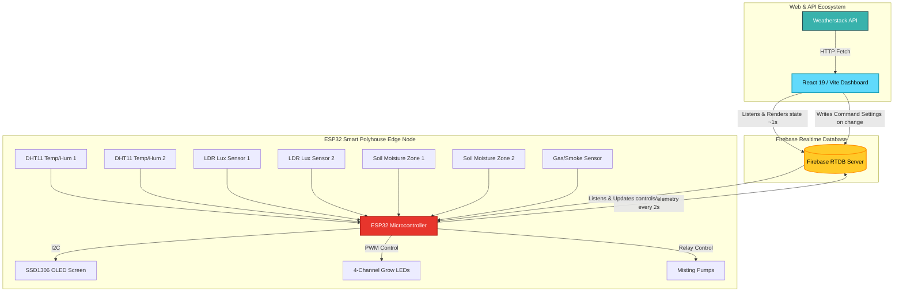

# 🌿 Smart Polyhouse — Grow Guardian 🚀

[](https://vitejs.dev/)
[](https://react.dev/)
[](https://www.typescriptlang.org/)
[](https://tailwindcss.com/)
[](https://firebase.google.com/)
[](https://www.espressif.com/)

An award-winning, state-of-the-art **Smart Polyhouse Automation & Greenhouse Monitoring Ecosystem**. This project couples a high-performance **React 19 Dashboard** with a robust **ESP32 Microcontroller Edge Node** via **Firebase Realtime Database** for seamless, low-latency environmental control and predictive agriculture analytics.

---

## 📸 Dashboard Preview & Aesthetic Design

The frontend dashboard is designed with a premium, sleek SaaS aesthetic:
* **Glassmorphism UI** with a curated, high-contrast dark/light mode palette.
* **Micro-animations** and smooth transition sequences for intuitive interaction.
* **Responsive Layouts** designed for tablets, desktop screens, and mobile devices.
* **Auto-closing mobile navigation** for simplified mobile operation.

---

## ⚡ Main Ecosystem Features

### 🖥️ 1. Intelligent Web Dashboard
* **Real-time Telemetry Panels**: Continuous streaming of ambient temperature, humidity, lighting (Lux), soil moisture (multiple zones), and toxic gas levels (MQ2).
* **Dual Control Operational Modes**:
  * **Auto Mode**: Self-regulating feedback loops adjust LED grow-lights and misting fans based on ambient sensor thresholds.
  * **Manual Override**: Real-time slider and toggle adjustments for fan switches, fine-tuned LED PWM duty cycles, and mist sprayers.
* **Historical Data Analytics**: Rich, beautiful data charts built with `recharts` for analyzing environmental trends.
* **3-Day Location-Aware Weather Forecast**: Dashboard integration with Weatherstack API offering dynamic UV indices, cloud cover percentages, and wind metrics.
* **Plant Growth Stage Tracker**: Comprehensive visual progression stages for tracking crops from germination to maturity.

### 🔌 2. ESP32 Hardware Edge Node
* **Dual DHT11 Sensors**: Multi-point temperature and humidity averaging for uniform crop climate tracking.
* **Dual Soil Moisture Zones**: Capable of tracing soil water saturation across different crop beds.
* **Dual LDR Light Detectors**: Accurately maps surrounding sunlight to regulate artificial grow-light intensities.
* **MQ2 Air Quality/Gas Sensor**: Safety integration triggering alarms on detecting high toxic gas or smoke levels.
* **Smart OLED Display SSD1306**: On-site telemetry display showing raw measurements, current PWM output, and database connection logs.
* **PWM Grow Light Modulation**: Consistently maintains target lux ranges using multi-channel high-frequency LED modulation.

---

## 🛰️ Architecture & Data Flow



---

## 🗺️ Microcontroller Pin Mapping

The microcontroller firmware is designed to operate on an **ESP32 development board (WROOM-32)**. Pins are mapped as follows:

| Sensor / Component | ESP32 GPIO Pin | Connection Type | Details / Purpose |
|:---|:---:|:---:|:---|
| **DHT11 (Temp & Hum 1)** | `26` | Digital Input | Air Temp & Humidity Zone 1 |
| **DHT11 (Temp & Hum 2)** | `33` | Digital Input | Air Temp & Humidity Zone 2 |
| **LDR 1 (Light Sensor)** | `27` | Analog Input (ADC1_CH17) | Raw Ambient Light Zone 1 |
| **LDR 2 (Light Sensor)** | `25` | Analog Input (ADC1_CH18) | Raw Ambient Light Zone 2 |
| **Soil Moisture 1** | `14` | Analog Input (ADC2_CH6) | Soil Water Percentage Zone 1 |
| **Soil Moisture 2** | `32` | Analog Input (ADC1_CH9) | Soil Water Percentage Zone 2 |
| **MQ2 Gas/Smoke Sensor** | `34` | Analog Input (ADC1_CH6) | Safety Smoke & Gas Telemetry |
| **SSD1306 OLED I2C SDA** | `21` | I2C Data | Local Telemetry Display Screen |
| **SSD1306 OLED I2C SCL** | `22` | I2C Clock | Local Telemetry Display Screen |
| **Grow LED 1 (PWM)** | `2` | PWM Output (CH0) | Dynamic Dimmable Light Bar 1 |
| **Grow LED 2 (PWM)** | `4` | PWM Output (CH1) | Dynamic Dimmable Light Bar 2 |
| **Grow LED 3 (PWM)** | `18` | PWM Output (CH2) | Dynamic Dimmable Light Bar 3 |
| **Grow LED 4 (PWM)** | `19` | PWM Output (CH3) | Dynamic Dimmable Light Bar 4 |

---

## ⚙️ Software Setup & Installation

Follow these steps to deploy and run the entire ecosystem locally:

### 1. Repository Setup & Dependencies
Clone the repository and install the Node packages inside the project root:
```bash
cd smart-polyhouse
npm install
```

### 2. Configure Firebase Integration
To initialize Realtime Database tables with realistic test telemetry, seed the database by running the pre-configured script:
```bash
node scripts/seed-firebase.mjs
```

In your **Firebase Console**, go to **Realtime Database** ➜ **Rules** and apply the following configuration for instant data flow:
```json
{
  "rules": {
    "sensors": {
      ".read": true,
      ".write": true
    },
    "controls": {
      ".read": true,
      ".write": true
    }
  }
}
```

### 3. Setup Environmental Variables
Create a `.env` file in the root of the project to add your Firebase configuration parameters and Weatherstack API keys:
```env
VITE_FIREBASE_API_KEY=YOUR_FIREBASE_API_KEY
VITE_FIREBASE_AUTH_DOMAIN=YOUR_PROJECT_ID.firebaseapp.com
VITE_FIREBASE_DATABASE_URL=https://YOUR_PROJECT_ID-default-rtdb.firebaseio.com
VITE_FIREBASE_PROJECT_ID=YOUR_PROJECT_ID
VITE_FIREBASE_STORAGE_BUCKET=YOUR_PROJECT_ID.appspot.com
VITE_FIREBASE_MESSAGING_SENDER_ID=YOUR_SENDER_ID
VITE_FIREBASE_APP_ID=YOUR_APP_ID
VITE_WEATHER_API_KEY=YOUR_WEATHERSTACK_API_KEY
```

### 4. Running the Dashboard locally
Launch the high-performance Vite development server:
```bash
npm run dev
```
Open [http://localhost:5173](http://localhost:5173) in your web browser to interact with the system.

---

## 🛠️ Microcontroller Firmware Upload

1. Open **Arduino IDE** or **VS Code (PlatformIO)**.
2. Install the following libraries via the Library Manager:
   * `WiFi.h`
   * `Firebase_ESP_Client` by Mobizt
   * `DHT sensor library` by Adafruit
   * `Adafruit SSD1306` & `Adafruit GFX Library`
3. Open `ESP32_Integration.ino` located in the root of this project.
4. Replace the placeholders on lines `14-19` with your WiFi Credentials and Firebase parameters:
   ```cpp
   #define WIFI_SSID "YOUR_WIFI_SSID"
   #define WIFI_PASSWORD "YOUR_WIFI_PASSWORD"
   #define DATABASE_URL "https://YOUR_PROJECT_ID-default-rtdb.firebaseio.com"
   #define DATABASE_SECRET "YOUR_FIREBASE_DATABASE_SECRET"
   ```
5. Select your target **ESP32 Dev Module** board and the correct COM Port.
6. Click **Upload** to compile and transfer the firmware.
7. Open the Serial Monitor set to `115200` baud to monitor telemetry updates.

---

## 🌾 Plant Optimization Rules (Automatic Mode)

* **LED Brightness Control**: When set to `Auto`, the system continuously checks the ambient average LDR light. If external sunlight is strong, it dims the grow lights; if sunlight drops, it seamlessly increases the PWM brightness (mapping `0 - 4095` to `255 - 0`) to assure perfect growth parameters.
* **Misting Fan Switch**: The system checks average air humidity. If humidity drops below `60%`, the misting relay automatically toggles `ON` to keep the climate humidified. Once target levels are satisfied, the relay toggles `OFF`.

---

## 📄 License & Attribution

This project is open-source. Created and maintained for advanced automated agriculture research. Feel free to fork, expand, and optimize your greenhouse! 🌿
